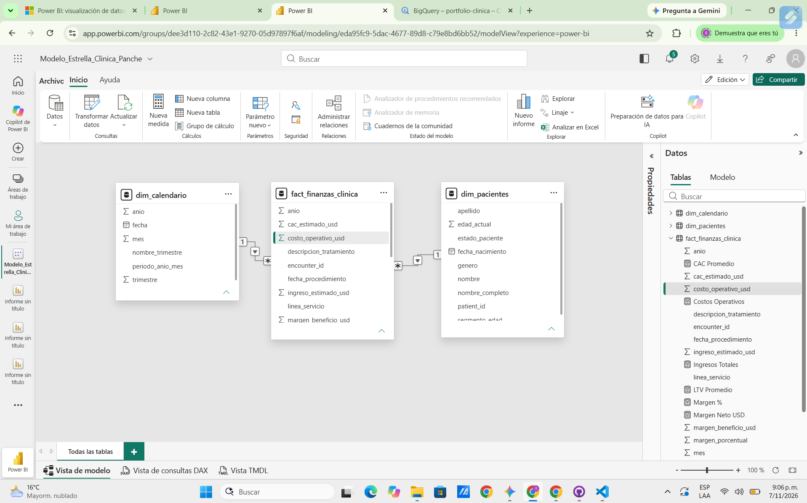
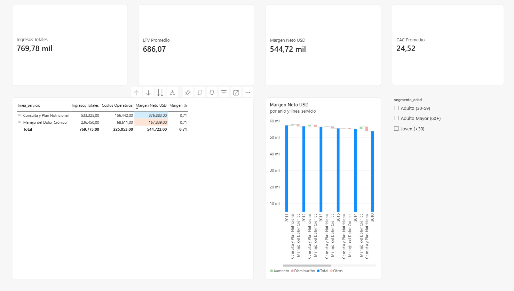

# 🏥 Análisis de Viabilidad Financiera y Expansión de Servicios Clínicos (P&L, LTV y CAC)

**Autor:** Sebastián Panche  
**Stack Tecnológico:** Google BigQuery (SQL) | Power BI (DAX & Star Schema) | Git & GitHub  
**Caso de Estudio:** Evaluación estratégica de rentabilidad — *Manejo del Dolor Crónico vs. Consulta y Plan Nutricional*

---

## 📂 Estructura del Repositorio
* 📄 [`01_limpieza_datos.sql`](./01_limpieza_datos.sql): Script SQL de limpieza demográfica, manejo de nulos (`COALESCE`), segmentación etaria y creación de tablas dimensionales (`dim_pacientes` y `dim_calendario`).
* 📄 [`02_transformacion_financiera.sql`](./02_transformacion_financiera.sql): Script SQL con *Common Table Expressions* (`WITH`), cruces relacionales (`LEFT JOIN`) e imputación del estado de resultados en la tabla de hechos (`fact_finanzas_clinica`).
* 📊 [`Dashboard_Rentabilidad_Clinica_Panche.pbix`](./Dashboard_Rentabilidad_Clinica_Panche.pbix): Archivo ejecutable de Power BI con el modelo semántico en estrella, medidas DAX y dashboard gerencial interactivo.

---

## 📌 Fase 1: Preguntar (Definición del Problema de Negocio)
La dirección médica de la clínica requiere evaluar con rigor estadístico y financiero la viabilidad de expandir dos líneas estratégicas de atención en medicina integrativa: **Manejo del Dolor Crónico** y **Consulta y Plan Nutricional**. 

### Preguntas Estratégicas de Investigación:
1. ¿Cuál es el margen de beneficio neto (en USD y %) que aporta la línea de Manejo del Dolor Crónico frente a la Consulta Nutricional?
2. ¿Cuál es la relación entre el Valor del Ciclo de Vida del Paciente (**LTV**) y el Costo de Adquisición (**CAC**) en cada servicio y segmento demográfico?
3. ¿Qué línea ofrece el mayor retorno financiero para escalar de forma masiva y cuál funciona mejor como servicio especializado de alto ticket?

---

## 🗄️ Fase 2: Preparar (Arquitectura de Datos en Google BigQuery)
Se utilizaron registros clínicos y transaccionales sintéticos (**Synthea**), alojados en el entorno cloud de Google BigQuery (`portfolio-clinica-513922.datos_clinicos`).

* **Tablas Fuente:** `pacientes` (Demografía), `encuentros` (Historial de admisiones) y `procedimientos` (Intervenciones clínicas).
* **Llaves Relacionales:** `patient_id` (Llave primaria demográfica) y `encounter_id` (Llave foránea transaccional).

---

## ⚙️ Fase 3: Procesar (Limpieza y Transformación SQL)
Todo el procesamiento ETL se ejecutó directamente en **Google BigQuery** para garantizar escalabilidad antes de conectar con Power BI:
* **Estandarización y Limpieza:** Uso de `SAFE_CAST` para fechas, `COALESCE` para imputación de diagnósticos no especificados y `DATE_DIFF` para el cálculo dinámico de edad y rangos etarios (*Joven <30*, *Adulto 30-59*, *Adulto Mayor 60+*).
* **Lógica Financiera (P&L):** Mediante bloques `WITH` (CTEs) y `LEFT JOIN`, se clasificaron los procedimientos clínicos en las dos unidades de negocio y se imputaron ingresos estimados, costos operativos directos y el Costo de Adquisición (CAC).

---

## 📊 Fase 4: Analizar (Modelo de Estrella y Medidas DAX en Power BI)
Se diseñó un **Modelo Semántico en Estrella (Star Schema)** conectando `dim_calendario` y `dim_pacientes` hacia la tabla central `fact_finanzas_clinica` mediante relaciones de cardinalidad **Uno a varios (`1:*`)** con filtro cruzado único.

### Medidas DAX Implementadas en el Modelo:
* `Ingresos Totales = SUM(fact_finanzas_clinica[ingreso_estimado_usd])`
* `Costos Operativos = SUM(fact_finanzas_clinica[costo_operativo_usd])`
* `Margen Neto USD = [Ingresos Totales] - [Costos Operativos]`
* `Margen % = DIVIDE([Margen Neto USD], [Ingresos Totales], 0)`
* `LTV Promedio = DIVIDE([Ingresos Totales], DISTINCTCOUNT(fact_finanzas_clinica[patient_id]), 0)`
* `CAC Promedio = AVERAGE(fact_finanzas_clinica[cac_estimado_usd])`

### Indicadores Financieros Globales Validados:
* **Ingresos Totales:** $769,78 mil USD
* **Costos Operativos:** $225,06 mil USD
* **Margen Neto Total:** $544,72 mil USD (**71% de margen bruto**)
* **LTV Promedio Global:** $686,07 USD por paciente
* **CAC Promedio Global:** $24,52 USD (**Ratio LTV/CAC de 27,9x**)

---

## 📈 Fase 5: Compartir (Dashboard Gerencial P&L)
El cuadro de mando ejecutivo integra tarjetas KPI superiores, una matriz jerárquica con formato condicional de barras de datos sobre el margen neto, un gráfico de cascada (*Waterfall Chart*) para el desglose P&L interanual y segmentadores demográficos interactivos.

### Desempeño Comparativo por Línea de Negocio (Global):
* **Consulta y Plan Nutricional:** Ingresos: **$690,82 mil USD** | Costos: **$200,28 mil USD** | Margen Neto: **$490,54 mil USD (71%)**.
* **Manejo del Dolor Crónico:** Ingresos: **$78,96 mil USD** | Costos: **$24,78 mil USD** | Margen Neto: **$54,18 mil USD (69%)**.

---

## 🚀 Fase 6: Actuar (Conclusiones y Recomendaciones Estratégicas)

1. **Escalamiento Masivo de Consulta Nutricional (Motor Principal de Flujo de Caja):**
   La línea nutricional genera el **90,05% del beneficio neto total de la clínica** ($490,54 mil USD) manteniendo un margen del **71%** y el menor costo de adquisición (**CAC de $20 USD**). Se recomienda destinar el **70% del presupuesto de pauta digital** a esta línea como servicio de entrada y recurrencia mensual.
2. **Paquetización Cruzada en Manejo del Dolor Crónico (Estrategia de Alto Ticket):**
   Aunque registra un menor volumen transaccional ($54,18 mil USD de margen neto), sus terapias e intervenciones mantienen una rentabilidad alta (**69% a 71%**). Se recomienda integrar protocolos conjuntos (*Terapia de Dolor + Plan Nutricional Antiinflamatorio*) para incrementar el LTV del paciente sin incurrir en un doble CAC.
3. **Priorización Comercial en el Segmento Adulto (30-59 años):**
   El análisis interactivo en el dashboard demuestra que el segmento de **30 a 59 años** alcanza un **LTV Promedio de $777,46 USD** (un **13,3% superior** al promedio general de $686,07 USD), aportando **$214,23 mil USD** en margen neto. Las campañas de captación corporativa y digital deben enfocarse prioritariamente en este perfil demográfico.